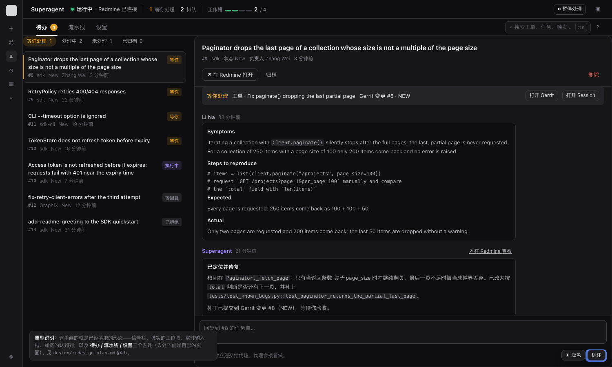
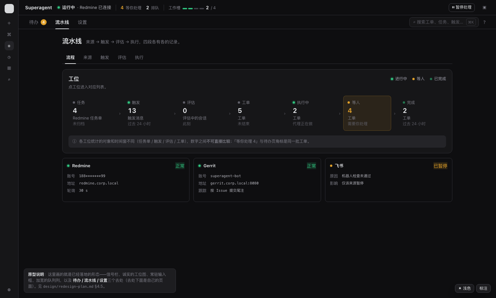
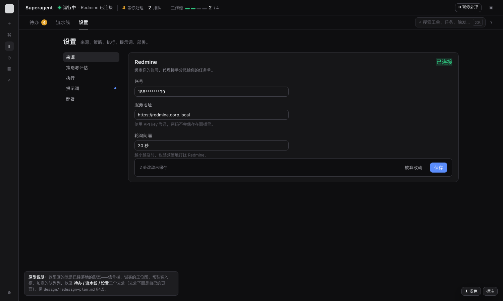

# 012 Superagent 面板改造：问题分析、改进计划与原型

面向 DeepSeek Harness 的 Superagent 面板（`dsh-superagent` 插件）当前的界面与交互问题分析，以及一版可落地的改造方案。

- 现状截图：`.artifacts/turn2-final-overview.png`、`.artifacts/turn2-final-workbench.png`、`.artifacts/turn2-overview-light.png`、`.artifacts/turn2-workbench-narrow.png`
- 可交互原型：`../prototype/redesign.html`
- 配套审计：[概览与工作台](audit-ops.md) · [记录页](audit-records.md) · [设置与设计系统](audit-settings.md)

---

## 0. 摘要

面板在**领域建模**上是扎实的：工单阶段、授权原因、Prompt 覆盖与默认值的比对，都做得很细。问题不在模型，在**把模型呈现出来的那一层**。归纳成三句：

1. **数与列表对不上。** 流水线的**七个工位里有三个**，图上写的数和你点进去看到的列表不是一回事：「执行中」统计的是 Executor 的**工作进程数**，链向**工单**列表；「完成」数过去 24 小时，链向**全部历史**工单；「评估」数**正在评估的会话**，链向一页**历史决策**。信号栏的「4 / 3 个任务在跑」把并发槽位说成任务；柱条把任务单数、触发数、工单数放在同一把尺子上比长短。这直接违反面板自己写下的第 5 条原则：「一个计数等于它所链接的列表的长度」。
2. **最要紧的信息只挂在一个页签上。** 七个顶层页签，没有任何角标。「现在有 4 件事等我」这个答案，只在「概览」这一个页面里，且要滚过仪表盘才看到。代理的全局急停开关「暂停处理」在第 6 个页签「执行」里。而「概览」那个答案本身也可能是**过期的**——轮询失败时绿信标照亮。
3. **主要动作离视线最远。** 工作台里唯一能推动工作的动作——回复任务单——在一段无界的对话的最末尾；这段对话显示的还是任务单描述的**原始源码**（行内代码的反引号是可见字符）。而工作台的「待处理」筛选是个混合袋，按更新时间排序，等你验收的工单可能排在第 40 位。

另有一处会**直接丢改动**的缺陷：部署页在面板和插件管理器里各有一个实例，而面板那一份的草稿没有 `key`，是整个面板唯一一个不写进 `sessionStorage` 的草稿——刷新页面就没了。

改造方向：**把 7 个页签收成 3 个，把仪表盘升成常驻信号栏，把「等你」变成整个面板的第一语言。**

---

## 1. 现状盘点

### 1.1 页面清单

| 页签 | 路由 | 内容 | 主要动作 | 备注 |
| --- | --- | --- | --- | --- |
| 概览 | `overview` | 实时横幅 + 流水线图 + 待处理工单 + 系统问题 | 停工单、恢复处理 | 落地页 |
| 工作台 | `pms` | Redmine 任务单列表（待处理/未处理/已归档）+ 选中任务的对话 | 回复任务单 | 默认落地页改为概览后被挤到第二 |
| 来源 | `source` | 来源状态、配置问题、非零计数 | 去修配置 | |
| 触发 | `trigger` | 会话列表（订阅中/评估中/24h 新触发/全部） | 重新评估、重试 | |
| 评估 | `eval` | 决策记录 + 原因 + 命中的规则 | 重新评估 | |
| 执行 | `execution` | 执行器状态 + 暂停处理 + 工单列表（未结束/待处理/执行中/等人/已结束） | 暂停/恢复处理 | 全局急停只在这里 |
| 设置 | `settings` | 来源 / 策略 / 执行 / 提示词 / 部署 五组 | 保存 | 左边有组内导航 |

### 1.2 面板要回答的三个问题，和七个页签的错位

面板文档（`docs/005-panel.md`）定下三个问题：

1. **现在有需要我的事吗？**
2. **系统健康吗，在做对的事吗？**
3. **一件工作的历史是什么（触发 → 评估 → 工单）？**

问题在于七��页签里，**两个是操作者目的地**（概览、工作台），**四个是代理内部阶段**（来源、触发、评估、执行），**一个是配置**（设置）。它们被放在同一层级、同一种视觉权重上。结果是：一次「谁在等我」的巡视要在 7 个页签里做一次分类。

### 1.3 现状外壳（线框）

```
┌────────────────────────────────────────────────────────────────────────────────┐
│ Superagent        [⌕ 搜索工单、线程、触发或链接]      [?]   [▣ 打开主 Session]  │
├────────────────────────────────────────────────────────────────────────────────┤
│  概览     工作台     来源     触发     评估     执行     设置                     │
│  ━━━━                                                                      │
├────────────────────────────────────────────────────────────────────────────────┤
│ ┌──────────────────────────────────────────────────────────────────────────┐ │
│ │ ●  运行中                                                                │ │
│ │    任务系统 已连接                          [等人 4]        0 / 3          │ │
│ │                                                 个任务在跑 ▬▬▬           │ │
│ └──────────────────────────────────────────────────────────────────────────┘ │
│ ┌──────────────────────────────────────────────────────────────────────────┐ │
│ │ 流水线 (?)  ●进行中 ●等人 ●已完成                            更新于 现在  │ │
│ │                                                                          │ │
│ │  任务 ── 触发 ── 评估 ── 工单 ── 执行中 ── 等人 ── 完成                  │ │
│ │   4      13     0       5      0        4        2                       │ │
│ │ 4个已接单 24小时 正在评估 未结束 0个排队中 需要你处理 24小时               │ │
│ │ ▬▬▬▬▬  ▬▬▬▬▬▬▬  ▬▬     ▬▬▬▬▬▬  ▬▬     ▬▬▬▬▬▬  ▬▬                     │ │
│ └──────────────────────────────────────────────────────────────────────────┘ │
│                                                                                │
│  待处理工单 4                                                                  │
│ ┃ 待验收 │ CLI --timeout option is ignored                                     │
│ ┃        │ [Redmine #11 New ↗][Gerrit #6 NEW ↗] 现在                         │
│ ┃        │ [⊙ 停止]                                                            │
└────────────────────────────────────────────────────────────────────────────────┘
```

三处结构性问题在这张图里已经可见：

- **横幅里的「等人 4」和流水线里的「等人 4」和下面的「待处理工单 4」是同一个数**，散在三个位置，没有任何绑定关系。
- **横幅说「运行中」，右边的数字却是「0 / 3 个任务在跑」。** 运行中 + 0，信号打架。
- **「等你」是第 6 个工位**——要看清「有 4 件事等我」，眼睛必须横向扫过 5 个不相关的数字。

---

## 2. 问题清单

按严重度排序。每条都标了代码位置，可以直接核对。

### P0 · 诚实性：数与它链接的列表对不上

> 违反面板自己的第 5 条原则：「一个计数等于它所链接的列表的长度，并且没有状态与另一个事实矛盾。」

**七个工位里，三个的计数和它链接的列表不是一回事。**

**P0-1 「执行中」工位统计的是工作进程，不是工单。**
`src/client/dashboard.tsx:65` 用 `data.executor.running` 作为「执行中」工位的计数；`src/app/views/pms.ts:193` 明确写着这个值是「Executor 忙碌的**工作进程**数」。而这个工位的链接是 `execution?filter=working`——一个**工单**列表。点进去看到的条目数和工位上写的数不是一回事。

**P0-2 「完成」工位数过去 24 小时，点开是全部历史工单。**
`src/app/views/pms.ts:219` 的 `ended` 只数过去 24 小时内结束的工单；但工位链向的 `execution?filter=ended`（`src/app/views/tickets.ts:38`）用的是 `store.tickets.list()`——**全部**已结束工单。图上写 2，列表里有 40。

**P0-3 「评估」工位数「正在评估的会话」，点开是一页历史决策记录。**
`src/client/dashboard.tsx:61` 用 `pipeline.evaluating`（正在评估中的线程数），链接到 `{ page: 'eval' }`，而 Eval 页默认筛选 `work`（`src/client/app.tsx:154`），列的是**已经做出的决策**。图上写「3 个正在评估」，点进去是一页过去的决策。

**P0-4 「4 / 3 个任务在跑」这句话本身是错的。**
`src/client/dashboard.tsx:43` 把 `executor.running` 和 `executor.max` 并排显示，`src/client/locales.ts:131` 给它配的说明是「个任务在跑」。但 `max` 是 `settings.executor.maxWorkers`（配置的并发上限），`running` 是当前占用的进程数。所以这是「N 个工作槽被占用 / 配了 M 个」，不是「N 个任务在跑」。浅色模式截图里它显示成 **4 / 3**——4 个任务跑在 3 个槽位里，读者无法解释。

**P0-5 柱条在比较不可比的量。**
`src/client/pipeline.tsx:26-29` 把每个工位的计数按「流水线里最大的那个」归一化后画成柱条。但七个工位量的是不同的东西、不同的窗口：

| 工位 | 图上写的数 | 实际量的是什么 | 窗口 | 链向的列表 |
| --- | --- | --- | --- | --- |
| 任务 | 4 | Redmine 任务单 | 未归档 | 工作台 · 全部 |
| 触发 | 13 | 触发消息 | 过去 24 小时 | 来源页 |
| 评估 | 0 | **正在评估的会话** | 此刻 | Eval · **历史决策** ⚠ |
| 工单 | 5 | 工单 | 未结束 | 执行 · 全部未结束 |
| 执行中 | 2 | **工作进程** | 此刻 | 执行 · **working 工单** ⚠ |
| 等人 | 4 | 工单 | 此刻 | 执行 · 等人 |
| 完成 | 2 | 工单 | 过去 24 小时 | 执行 · **全部历史** ⚠ |

柱条让「工单 5」和「触发 13」看起来可以比大小，实际上一个是存量、一个是 24 小时流量。

**P0-6 同一个数在一屏里出现三次，三种字号，绑定关系不明。**
横幅的「等人 4」chip（11px）、工位图的「等人 4」（22px）、「待处理工单 4」标题（14px）——三处都是 `pipeline.waiting`，用三种字号印在同一屏上。「执行中」也印两遍（28px 的横幅大数 / 22px 的工位数）。读者要自己推断它们是不是同一批。

**P0-7 屏幕上的状态可能是过期的，而且看起来是对的。**
- **轮询失败时绿信标继续亮**：`overview.tsx:63-69`，`usePoll` 出错时保留上一次成功的值，错误只是横幅上方一行泛泛的文字。任务系统停了，横幅照样显示「运行中」和绿色脉冲信标。横幅是全页唯一没有时间戳的大块（`dashboard.tsx:86` 的「更新于」属于流水线卡片，不属于横幅）。
- **两个轮询可以互相矛盾**：概览用 `GET overview` 和 `GET pms` 两个独立轮询（`overview.tsx:63-64`），服务端在不同时刻构建。横幅说「1 条在等人」，下面的工单列表还是 5 秒前的 0 条。
- **列表和详情是两个时钟**：工作台列表 5 秒一轮（`pms.tsx:48`），详情 4 秒一轮（`conversation.tsx:38`）。行上的徽标说「分析中」，详情已经说「等你处理」。

**P0-8 任务系统不可达时，空状态讲了一句假话。**
`src/client/pms.tsx:40`：列表为空时渲染 `t('pmsNoTasks')` = 「**没有指派给你的任务。**」（`locales.ts:161`）。但任务系统挂掉时 `readInbox` 返回 `issues: []`（`app/views/pms.ts:148`），列表同样是空的。错误信息确实显示在它上面一行（`pms.tsx:58`），但紧跟着的空状态仍然断言「没有任务给你」。这里应该说「任务系统连不上」，而不是断言事实。

### P0 · 发现性：最要紧的信息只挂在一个页签上

**P0-9 七个页签没有任何角标。**
`src/client/app.tsx:166-167` 的 `SegmentedTabs` 只渲染标签文字。操作者在任何其他页签上，**无法知道有 4 件事在等他**。这是整个面板最贵的一个问题：面板存在的理由是「监督一个主动干活的代理」，而监督的第一步——扫一眼有没有人在等我——没有做成。

**P0-10 全局急停开关在第五个页签之后。**
`src/client/execution.tsx:35` 是「暂停处理」的唯一常驻控件。概览页的横幅能显示「已暂停」，但横幅本身不给恢复按钮；唯一在概览的恢复入口是 `src/client/overview.tsx:36-39` 的问题行，那行在整页仪表盘和工单列表**下面**，而且只在 `executor-paused` 这一种问题上出现。急停键应该和状态读数放在一起。

### P1 · 操作性：主要动作离视线最远，筛选名不副实

**P1-9 工作台的主要动作在页面最末尾。**
`src/client/pms.tsx:69` 渲染的 `Conversation` 把对话和输入框按顺序放在详情列里（`src/client/conversation.tsx:80-91`）。对话是任务单描述的全文，可以很长；输入框在它下面。文档里写的是「The composer sends a reply as a note on the issue」——**唯一能推动工作的动作**被一段无界文本推到了屏幕外。

**P1-10 工作台对话显示的是任务单描述的原始源码。**
`src/client/conversation.tsx:19`：`<p className="dt-chat-text">{message.text}</p>`，配 `white-space: pre-wrap`（`client.css:496`），**没有任何 Markdown 渲染**。面板本身有 `MarkdownLite`（`widgets.tsx:52`），并且在 `ticket.tsx:26,144` 用得好好的——只是对话没用。

证据（把 `.artifacts/turn2-final-workbench.png` 放大到原分辨率后可见）：代码块里的行内代码标记是**可见的反引号字符**——

```
# `from demo_sdk import Client` (with a client whose `paginate()` talks to the projects endpoint)
# `items = list(client.paginate("/projects", page_size=100))`
```

任务单描述是操作者最需要读的那段内容，现在它带着源码噪声：反引号、`#` 注释符、`##` 标题符号混在正文里，读起来像坏掉了。

**P1-11 「待处理」是个混合袋，等你的事可能排在第 40 位。**
`src/client/pms.tsx:39` 的 `active` 筛选取的是 `data.tasks`——`app/views/pms.ts:204-210` 把「未关闭且没被拒绝」的任务单全塞进来，**里面混着待分析、分析中、等你处理、已完成**四种状态。排序是 Redmine 的 `sort: 'desc'`（`app/views/pms.ts:142`），即按**更新时间**倒序。于是「待处理 4」这个标签既不表示「等你处理」，也不保证「等你处理」的东西排在前面——一个等着你验收的工单，可能排在 40 条刚被碰过的任务单之后。

**P1-12 删除和归档并排同权；归档之后行直接消失，无法撤销。**
`src/client/conversation.tsx:67-74` 的头部动作区：「归档」（可逆）和「删除」（不可逆，只有一层确认弹窗）都是同样尺寸的小按钮并排放，删除只多一个垃圾桶图标来区分。更麻烦的是归档后没有 toast、没有撤销入口，行直接从列表里消失（`pms.tsx:15` 的 `toggle` 只做 `reload`），而它和「删除」的视觉差异极小。误归档 = 误以为任务被删了。

**P1-13 行内动作要悬停才出现。**
`src/client/client.css:468-469`：`.dt-task-actions` 默认 `opacity: 0`，只有 hover / 选中 / 聚焦时才出现。「归档这个任务」这个动作，笔记本用户必须逐行悬停才能发现。同样的做法也用在 Thread 的「重新评估」上（`thread.tsx:50` 用了 `dt-reveal`），而那是**唯一**一条重新评估的路径。

### P1 · 记录页：详情页把主角排到了后面

> 这一组来自 [记录页审计](audit-records.md)（45 条发现，15 条 High）。这里只收会改变改造方案的。

**P1-14 Thread 详情把时间线排在第四位。**
`src/client/thread.tsx:140-168` 的顺序是：订阅此线程的工单 → 决定（默认折叠）→ 关联 → 时间线 → 取消订阅。这个页面的存在理由是「追踪一件工作的历史」，但真正的时间线排在三个区块之后。而 `docs/005-panel.md:22` 自己写的是「Triggers newest first, Decisions and Subscriptions」——**文档顺序和代码顺序也不一致**。

**P1-15 只有一个派工时，Ticket 详情完全不显示派工。**
`src/client/ticket.tsx:167`：`{data.assignments.length > 1 && <Details .../>}`，注释说「一条派工在状态行之外不增加信息」。但状态行（`ticket.tsx:137-142`）只有阶段、授权强度、发起人、更新时间——**没有任何派工信息**。于是最常见的情况下，操作者看不到：哪个 worker 在跑、什么时候开始的、上一次报告是什么。`docs/011-interaction-scenarios.md:131-134` 记录的第一个走查失败（「assignment 一直显示运行中」）恰好只能靠派工记录解释——而它被藏起来了。

**P1-16 决策列表丢掉了「不匹配的规则」和原因。**
`src/client/rows.tsx:80,97` 只保留**命中**的规则名。而操作者真正要回答的是「为什么没接这个单」——那通常恰恰是**没命中**的规则加准入原因。这些信息只在 Ticket 详情里有，而很多决策根本没有 Ticket，于是完全看不到。

**P1-17 所有列表页都不显示总数。**
服务端 `page()` 返回 `{ items, total, next_offset }`（`src/app/views/records.ts:14`），但客户端**没有任何一处渲染 `total`**（`grep -rn "total" src/client/*.tsx` 无结果）。于是「截断的列表」和「完整的列表」长得一模一样，操作者无法判断自己是不是只看到了一部分。

### P1 · 设置页：同一份配置有两个界面，其中一个会丢改动

> 这一组来自 [设置与设计系统审计](audit-settings.md)（50 条发现，7 条 High）。

**P1-18 部署页在面板和插件管理器里各有一个，两个草稿互不可见，而面板那份刷新就丢。**
两处渲染的是同一个 `DeploymentPage` 组件（`settings.tsx:23` 与 `deployment.tsx:90-97`，后者挂在 `plugins.row.config` 槽位），但各自建了自己的 `useDraft`。关键差别在 `deployment.tsx:38`：

```ts
const draft = useDraft({ saved: …, revision: …, reload: async () => {}, save: … })   // ← 没有 key
```

而 `settings-kit.tsx:37` 是 `useDraft({ key: 'dsh-superagent/draft/…', … })`。`draft.tsx:142` 的写盘 effect 第一行就是 `if (!key) return` —— **部署页的草稿是整个面板唯一一个不写进 sessionStorage 的草稿，刷新页面就没了**。同时两棵树对同一份宿主配置各持一份草稿：在面板里改的限额，在插件管理器里看不见，反之亦然；冲突时只给一句笼统的「设置在别处改过」，不告诉你是哪个限额撞了。

**P1-19 设置页没有任何撤销，草稿在所属卡片之外不可见。**
唯一的后退是「放弃改动」，而且**不确认**——一次点击丢掉整张卡片（来源卡）或整份提示词。同时导航上看不出哪个组有未保存的草稿：切走再切回来，草稿还在，但没有任何提示。也没有 `beforeunload` 保护。

**P1-20 保存条没有「保存中」状态，失败被截断，校验报错是裸路径。**
保存进行中时，保存条仍然显示「未保存 · 草稿已保留」；三个来源卡各有一条自己的红条，错误被 `dt-clamp` 截到三行且**没有展开入口**；校验失败报的是 `sources.redmine.config.apiKey` 这类裸路径，服务端给的说明被丢掉了。

### P1 · 布局：列表最挤，断点错位

**P1-21 列表列被钉死在 320px，标题被截成不可用的碎片。**
`src/client/client.css:448`：`.dt-inbox { grid-template-columns: minmax(240px, 320px) minmax(0, 1fr); }`。而工作台那一列是**操作者的索引**——正是最需要读全标题的地方。真实截图里：`Access token is not refreshed before it ex…`、`Paginator drops the last page of a collecti`（后面还压着删除图标）。详情列拿到了剩下的全部宽度，用来放一屏可以滚很久的 Markdown。

**P1-22 单列断点（640px）远低于双列可用宽度（≈900px）。**
`src/client/client.css:505-511` 在容器宽度 ≤640px 时切到单列并**整列隐藏列表**（`.dt-inbox[data-selected] .dt-inbox-list { display: none }`）。但双列真正难看的区间是 640–900px：列表被挤到 240px，标题全是省略号。断点应该跟着「双列是否还有意义」走，而不是跟一个任意数字走。

**P1-23 窄容器下流水线折成两列，连接线被删掉，流向读不出来。**
`src/client/client.css:86-90`：容器 ≤640px 时 `.dt-pipe` 折行、`.dt-pipe-link { display: none }`。流水线唯一不可替代的贡献就是**流向**，删掉连接线之后它变成两行互不相干的数字。侧栏展开时面板宽度很容易掉进这个区间。

**P1-24 概览页的动作列表把阶段标签重复四遍。**
`src/client/client.css:387`：`.dt-list > .dt-ticket` 是 `grid-template-columns: 112px minmax(0,1fr)`——每行左侧留 112px 放「待验收」。四行都是「待验收」时，这一列是纯粹的重复，还吃掉了 25% 的标题宽度。

**P1-25 「等你处理」的列表从第一屏底部才开始。**
概览页的纵向预算：横幅 ≈120px + 流水线 ≈200px，之后才开始工单列表。回答「现在有需要我的事吗」需要先滚过两百像素的仪表盘。

### P2 · 一致性：状态词、尺度、圆角、术语

**P2-19 三套状态词表、四套圆点实现。**
- `Dot`/`StateDot` 的状态：`done | warning | ongoing | error | idle`（`controls.tsx:140`）
- `Tag` 的色调：`outline | neutral | quiet | success | info | warning | danger`（`controls.tsx:62`）
- `StageMark` / `.dt-stage[data-state]`：`warning | error | ongoing | person`（`client.css:405-409`）
- 圆点有四种实现：`.dt-state-dot`、`.dt-station-light`、`.dt-live-beacon`、`.dt-rule-dot`

同一个「等你」在概览页、在执行页、在工作台行里，颜色和词都不一样。

**P2-20 灰点配红标签：状态点和色调被分开指定。**
`src/client/marks.ts:50-56` 的 `DECISION_MARKS` 里，`dot` 和 `tone` 是两个独立字段：

```ts
stop:          { dot: 'idle',    icon: 'stop',    tone: 'danger'  },
wouldAccept:   { dot: 'idle',    icon: 'dismiss', tone: 'warning' },
```

于是「停止」这个决定渲染出**一个灰点旁边一个红标签**，「本会接单」渲染出**灰点 + 琥珀标签**。两个标记在同一行里互相打架，读者只能靠猜。根因是状态被拆成了两个可以独立指定的通道——应该是一张表，一行一状态。

**P2-21 字号 10 档、圆角 15 档。**
`client.css` 里出现 11/12/13/14/15/16/17/20/22/28px 十种字号，和 1/2/4/6/7/8/9/10/12/14/16/18/24/999px 十四种圆角。11px 已经低于舒适阅读下限，浅色模式下几乎糊成一片。

**P2-22 应用名「Superagent」是全页最小的字。**
`client.css:13`：`.dt-title { font-size: 15px; color: var(--dsw-alias-label-secondary); }`。面板嵌在宿主侧栏里，除了这句话没有别的品牌锚点，而它是 10 档字号里偏小的那一档，还用了弱化色。

**P2-23 「工单」一个词指两样东西。**
中文里「工单」既指 Redmine 上那条任务单，也指 agent 的 Ticket——而两者共用 `#42` 这样的编号空间。面板文档自己在「one place per concept」原则里要求一个概念一个地方，但这个词把两个概念叠在了一起。

**P2-24 同一个 Redmine 任务单，一处叫「事务」，一处叫「任务」。**
来源设置、搜索提示、删除确认里叫「事务」，工作台里叫「任务」。同一个对象两个名字，操作者要自己判断说的是不是同一件事。

**P2-25 五个设置组里，三个和顶层页签同名。**
`settingsGroup.eval` = `tab.eval` = 「评估」，`settingsGroup.execution` = `tab.execution` = 「执行」，`settingsGroup.source` 和 `tab.source` 中文同为「来源」。点「评估」想看决策流水，落到的是准入规则页。设置组应该按「配置什么」命名——「来源配置」「策略与准入」「执行器」。

**P2-26 宿主有完整的字号刻度，面板 97 处硬编码，一个 token 没用。**
见 §3.2「尺度收敛」。这是宿主唯一设计成共享的一族 token，面板整个绕开了它。

**P2-27 `controls.tsx` 重造了宿主已有的 9 个原语。**
`controls.tsx:1-4` 自己写着「Mirrors DSH ui-primitives markup and keyboard behavior without coupling to its internal package API」。但 `@deepseek-ai/dsh-client-ui-primitives` 是公开包（npm 上有 0.0.1-rc.1，宿主自己有 5 个包依赖它），导出了 `Button`、`Pill`、`Input`、`Modal`、`Tooltip`、`Toast`、`StateDot`、`DisclosureRow` 和整套 `ic_ds_*` 图标。面板自造了这 9 个里的 9 个，外加 35 个手绘图标和自己的焦点陷阱。后果：面板的控件继承不到宿主的行为修复（焦点环、hover、reduced-motion、RTL），用不了宿主已有的能力（宿主的 `Modal` 支持 `headless`/`contentClassName`，`Tooltip` 支持 `delayMs`/`side`/`maxWidth`，`DisclosureRow` 支持 `expandable`），并且会和周围的 Harness 界面**看起来不一样**。

**P2-28 `Field` 的标签指向不存在的控件。**
`settings-kit.tsx:56-63` 渲染 `<label htmlFor={id}>` 并给子元素注入 `id`；但 `SegmentedControl`（`controls.tsx:113`）和 `Switch`（`controls.tsx:132`）解构固定属性、**没有 `...rest`**，注入的 `id` 被静默丢弃。于是分段控件和开关的可见标签点了没反应，也没有程序化关联。

**P2-29 `.dt-open::after` 整行点击的技巧有副作用。**
`client.css:101-105` 用一个绝对定位的伪元素把整行变成可点区域。为了让它不挡住子控件，又要在三个容器上写 `pointer-events: none` + 子元素 `auto`（`client.css:399-400`）。副作用：行内文本无法被选中。

**P2-30 术语表是一张 680px 的双语表，只能靠一个「?」按钮找到。**
`app.tsx:28-56` + `client.css:177`。术语（触发/评估/工单/线程）散落在各页，没有内联解释；兜底方案是一个需要主动想起来才去点开的模态表。

**P2-31 搜索只能回车触发，没有键盘导航，结果不分类型。**
`app.tsx:116-123`：`submit` 里才发请求，没有防抖、没有增量结果。结果是一个扁平列表，混着工单 / 线程 / 触发三种记录（`app.tsx:81-96`），没有分组、没有类型筛选、不能用方向键移动。20 条封顶（`app.tsx:77`）。

**P2-32 过滤条件互不排斥，也没有分组语义。**
「全部」包含其他所有过滤，「未结束」又包含「等人/执行中/空闲」——操作者算不出覆盖关系。三张列表页的过滤条还都缺 `role="group"`（工作台的过滤条做对了，`pms.tsx:61`）。

**P2-33 中英混排的状态值。**
`#8 sdk 状态 New 负责人 Zhang Wei`——面板自己的一套状态词（分析中 / 等你处理 / 已完成）和 Redmine 的原始状态（New）挤在同一行里。

### P2 · 空状态与反馈

**P2-34 「没有需要你处理的事」是一句提示，不是邀请。**
`overview.tsx:73`：`<Hint>{t('needsYouNone')}</Hint>`。原则 6 说「空状态是邀请，而不是情绪」。这里没有告诉操作者「现在该做什么」。

---

## 3. 改进计划

### 3.1 信息架构：7 个页签 → 3 个

核心动作：**把代理的内部阶段从顶层降为子层，把「需要我」提到唯一的顶层。**

```
现状                                    改造后
┌───────────────────────────────┐      ┌───────────────────────────────┐
│ 概览    工作台                │      │ 任务工作台  流水线      设置    │
│ 来源    触发    评估    执行     │  →   │  ├ 来源  触发  评估  执行    │
│ 设置                         │      │  └ 子层：四段各管各的记录     │
└───────────────────────────────┘      └───────────────────────────────┘
```

| 新结构 | 内容 | 来自 |
| --- | --- | --- |
| **信号栏**（常驻，不是一个页签） | 运行状态、等你处理数、排队数、工作槽占用、**暂停/恢复处理** | 概览横幅 + 执行页的暂停按钮 |
| **待办**（落地页） | 需要人的所有事：等你处理 / 执行中 / 等回复 / 已拒绝 / 已归档；选中后右侧是详情 + 常驻输入框 | 概览的「待处理工单」+ 工作台 + 执行页的「等人」筛选 |
| **流水线** | 上半：诚实的工位图；下半：子层页签 来源 / 触发 / 评估 / 执行 | 概览的流水线图 + 来源 / 触发 / 评估 / 执行四页 |
| **设置** | 不变：来源 / 策略 / 执行 / 提示词 / 部署 | 设置 |

这样一来：

- **「等你处理 4」出现在两个地方且互相绑定**：导航角标 + 信号栏。任何页签都能看到。
- **急停键和状态读数在一起**：信号栏右侧。
- **顶层只剩三个**，每个只回答一个问题。

### 3.2 设计方向

面板跑在 Harness 宿主里，配色由宿主的 `--dsw-alias-*` 令牌决定。因此这次改造**不另起调色板**，走**结构 + 排版 + 层级**路线——这也避免了给一个工具型界面套一层新皮肤。

**一、诚实的工位图。**

去掉归一化柱条；每个工位写清「统计什么」和「什么时间窗」；「执行中」改用工单数；工作进程数搬进信号栏的「工作槽」。

```
改造前（柱条在比不可比的量）              改造后（每个工位说清口径）
 任务 ─ 触发 ─ 评估 ─ 工单 ─ 执行中 ─ 等人 ─ 完成    任务   触发   评估   工单   执行中  等人   完成
  4     13     0      5      0        4      2        4      13     0      5      2      4     2
 ▬▬▬   ▬▬▬▬▬▬  ▬      ▬▬▬▬▬   ▬       ▬▬▬▬▬   ▬▬    任务单 触发消息 评估中 工单  工单  工单  工单
                                              过去24h  此刻   未结束 代理在做 需你处理 过去24h
```

只有「等人」带暖色底——整张图里唯一需要人动手的工位。

**二、尺度收敛——用宿主自己的刻度，不要另起一套。**

面板跑在宿主里，宿主**已经有一套完整的字号刻度**（`dsh-client-ui-theme`）：`--dsw-font-xxxs-11` / `xxs-12` / `xs-13` / `s-14` / `base-16` / `m-18` / `l-20` / `xl-24`，每一档都带 `-font-size`、`-font-weight`、`-line-height`、`-font-family`。

而面板的 `client.css` 里有 **97 处硬编码的 `font-size: Npx`**，**一个宿主字号 token 都没用**——其中 15 / 17 / 22 / 28px 四档根本不在宿主的刻度上。所以「收敛」不是自己定一套 5 档，而是**把每一处映射到宿主 token**，把 4 个离线尺寸挪上刻度。

| | 现在 | 改造后 |
| --- | --- | --- |
| 字号 | 10 档硬编码 px（11/12/13/14/15/16/17/20/22/28），0 个用宿主 token | 宿主 8 档 token 中实际用 5–6 档；4 个离线尺寸（15/17/22/28）改用 token |
| 圆角 | 1 / 2 / 4 / 6 / 7 / 8 / 9 / 10 / 12 / 14 / 16 / 18 / 24 / 999（14 档） | 4 / 8 / 12 / 999（4 档） |
| 状态词 | 3 套词表、4 套圆点 | 1 套 5 词：进行中 / 等你 / 出错 / 已完成 / 空闲 |
| 控件 | 自造 9 个宿主已有的原语（Button / Pill / Input / Modal / Tooltip / Toast / StateDot / DisclosureRow + 35 个手绘图标） | 改用 `@deepseek-ai/dsh-client-ui-primitives`，只留面板特有的几个 |

**三、任务工作台的版式。**

```
┌ 任务工作台 ─────────────────────────────────────────────────────────────┐
│ ┌──────────────┬────────────────────────────────────────────────────┐ │
│ │ [等你处理 4] │ Paginator drops the last page of a collection …    │ │
│ │ [执行中 2]   │ #8 · sdk · New · Zhang Wei · 3 分钟前              │ │
│ │ [等回复 1]   │ [在 Redmine 打开] [归档]              [删除]      │ │
│ │ [已拒绝 1]   │ ┌────────────────────────────────────────────────┐ │ │
│ │ [已归档 0]   │ │ 等你处理 · 工单 Fix paginate()…  Gerrit #8 NEW │ │ │
│ │              │ │                          [打开 Gerrit][Session] │ │ │
│ │ ▸ Paginator… │ │ └────────────────────────────────────────────────┘ │ │
│ │   等你        │ │ 对话                                               │ │
│ │ ▸ RetryPol…  │ │  Li Na 33分钟前   ┌──────────────────────────┐  │ │
│ │   等你        │ │  ┌────────────────────────────────────────────┐  │ │ │
│ │ ▸ CLI --time… │ │  │ Symptoms …                                    │  │ │ │
│ │   等你        │ │  └────────────────────────────────────────────┘  │ │ │
│ │   (340–400px) │ │                        ┌──────────────────┐    │ │ │
│ │              │ │                        │ Zhang Wei 我这边 │    │ │ │
│ │              │ │ ───────────────────────┴──────────────────┴────┘ │ │
│ │              │ │ [回复到 #8 的任务单…                    ] [发送] │ │  ← 常驻
│ └──────────────┴────────────────────────────────────────────────────┘ │
└───────────────────────────────────────────────────────────────────────┘
```

四处改动：

1. **列表列宽 340–400px**（原来上限 320px），标题允许两行，不再截成碎片。
2. **对话是一个有界的滚动区**，输入框**常驻在底部**，不随对话长度漂走。
3. **阶段词做成右对齐的小标签**（等你 / 执行中 / 等回复 / 已拒绝），不再占一整列 112px。
4. **删除移到最右并单独成组**，与可逆的「归档」拉开距离。

**四、搜索变成命令面板。**

`⌘K` / `Ctrl+K` 打开，增量搜索，按类型分组（工单 / 任务单 / 触发），方向键移动，回车打开，同时容纳命令（暂停处理、跳到待办、打开设置）。命中词高亮。20 条封顶时明说「共 N 条，显示前 20 条」。

**五、术语就地解释。**

行内术语（触发 / 评估 / 工单）加内联 ⓘ，点开是一句话解释 + 术语表链接；术语表本身降级为「参考」，不再占据「?」按钮这个唯一的入口。

### 3.3 分批落地

| 批次 | 内容 | 触及 | 收益 |
| --- | --- | --- | --- |
| **B1 数据诚实** | 三个工位改口径（执行中→工单数、完成→24h、评估→加「进行中」筛选）；信号栏的 `running/max` 改文案；工位图去掉归一化柱条并写清口径；横幅加数据年龄；概览合并成一个快照；空状态不撒谎 | `dashboard.tsx` `pipeline.tsx` `locales.ts` `app/views/pms.ts` `app/views/tickets.ts` `overview.tsx` | 消除 P0-1 ~ P0-8。这是**唯一会让操作者做错决定**的一组，优先做。 |
| **B2 发现性** | 导航角标；信号栏常驻（状态 + 等你数 + 排队 + 工作槽 + 暂停/恢复） | `app.tsx` `route.ts` `controls.tsx`（`SegmentedTabs` 支持角标） | 消除 P0-9、P0-10。 |
| **B3 结构** | 页签 7 → 3；待办合并概览动作区与工作台；流水线子层化；Thread 时间线提到第一位；派工恒显示；设置组改名去掉与页签的撞名 | `app.tsx` `route.ts` `overview.tsx` `pms.tsx` `execution.tsx` `thread.tsx` `ticket.tsx` `settings.tsx` | 消除 P1-9、P1-14 ~ P1-17、P1-25、P2-23 ~ P2-25。 |
| **B4 版式** | 列表列宽 + 对话有界滚动 + 常驻输入框 + 断点重定 + 窄屏保留流水线流向 + 去掉 112px 阶段列 | `client.css` `conversation.tsx` `pms.tsx` `pipeline.tsx` | 消除 P1-10 ~ P1-13、P1-21 ~ P1-24。 |
| **B5 一致性** | 字号全部映射到宿主 token；圆角 4 档；状态词 1 套（点与色不再分开指定）；改用宿主原语；术语内联 ⓘ；删除按钮隔离；`Field` 标签可关联 | `client.css` `controls.tsx` `marks.ts` `widgets.tsx` `settings-kit.tsx` `locales.ts` `package.json` | 消除 P2-19 ~ P2-22、P2-26 ~ P2-31。 |
| **B6 检索与反馈** | `⌘K` 命令面板；列表页显示总数；行标题不再一行截断；空状态改成邀请；过滤条分组并互斥 | `app.tsx` `controls.tsx` `rows.tsx` `locales.ts` | 消除 P2-32 ~ P2-34。 |

| **B7 设置的可靠性** | 部署草稿补 key 并与插件管理器合流；加撤销；草稿在导航上可见；保存条加「保存中」态与字段级错误；校验失败给字段名 | `deployment.tsx` `draft.tsx` `settings-kit.tsx` `app.tsx` | 消除 P1-18 ~ P1-20。**B7 里那条草稿丢失是唯一会丢用户数据的缺陷，可以独立先修。** |

B1 和 B2 可以先独立合并——它们改动面小，但解决的正是最贵的两个问题。B3 是最大的一刀，需要先定好 `GET pms` 的返回结构（B1 会先改它）。

---

## 4. 线框对照

### 4.1 外壳

```
现状                                   改造后
┌──────────────────────────────┐     ┌────────────────────────────────────────────┐
│ Superagent  [⌕ 搜索…] [?] [▣] │     │ Superagent ●运行中·Redmine已连接 │4 等你处理 ││
├──────────────────────────────┤     │   │2 排队│工作槽▮▮▯▯ 2/4│   [⏸ 暂停处理]  ││
│ 概览 工作台 来源 触发 评估     │     ├────────────────────────────────────────────┤
│ 执行 设置                     │  →  │ 任务工作台  流水线  设置   [⌕ 搜索… ⌘K] [?] │
│                              │     │ ━━━━                                      │
│ (状态只有概览页有)             │     │                                            │
│ (急停只有执行页有)             │     │ (状态 + 急停在每一页都有)                    │
└──────────────────────────────┘     └────────────────────────────────────────────┘
```

### 4.2 概览 → 流水线

现状：概览页把三件事挤在一页——仪表盘（横幅 + 七工位图）、要人处理的事、系统问题。

```
┌ 概览 ───────────────────────────────────────────────────────────────────────┐
│ ┌──────────────────────────────────────────────────────────────────────────┐ │
│ │ ● 运行中  任务系统 已连接              [等人 4]            0 / 3         │ │
│ │                                            个任务在跑 ▬▬▬                │ │
│ └──────────────────────────────────────────────────────────────────────────┘ │
│ ┌──────────────────────────────────────────────────────────────────────────┐ │
│ │ 流水线 (?)  ●进行中 ●等人 ●已完成                          更新于 现在   │ │
│ │  任务 ─ 触发 ─ 评估 ─ 工单 ─ 执行中 ─ 等人 ─ 完成                        │ │
│ │   4     13     0      5      0        4        2      ← 要横扫 5 个数     │ │
│ │ ▬▬▬▬▬  ▬▬▬▬▬▬▬  ▬     ▬▬▬▬▬▬  ▬       ▬▬▬▬▬▬  ▬▬▬                    │ │
│ └──────────────────────────────────────────────────────────────────────────┘ │
│                                                                              │
│ 待处理工单 4                              ← 回答问题①的列表，到这里才开始     │
│ ┃ 待验收 │ CLI --timeout option is ignored                                  │
│ ┃ 待验收 │ RetryPolicy retries 400/404 responses                           │
│ ┃ 待验收 │ Fix paginate() dropping the last partial page                   │
│ ┃ 待验收 │ TokenStore does not refresh token before expiry                │
└──────────────────────────────────────────────────────────────────────────────┘
```

改造：横幅升为常驻信号栏；工位图进「流水线」并说清口径；工单列表进「待办」并排在最前。

```
┌ 流水线 ─────────────────────────────────────────────────────────────────────┐
│ 来源 → 触发 → 评估 → 执行                                                     │
│ ┌──────────────────────────────────────────────────────────────────────────┐ │
│ │ 工位                                    ●进行中 ●等人 ●已完成             │ │
│ │  任务      ›  触发      ›  评估      ›  工单      ›  等人      › 完成    │ │
│ │  4            13           0           5           4           2        │ │
│ │  Redmine     触发消息    评估中的     工单        工单        工单       │ │
│ │  任务单                  会话                    需要你处理              │ │
│ │  未归档      过去24小时    此刻        未结束      过去24小时              │ │
│ │                                              ▓▓▓▓ ← 唯一的暖色工位     │ │
│ │ ⓘ 各工位统计的对象和时间窗不同，数字之间不可直接比较。                    │ │
│ └──────────────────────────────────────────────────────────────────────────┘ │
│ ┌ Redmine ─────┐ ┌ Gerrit ──────┐ ┌ 飞书 ───────┐                        │
│ │ ● 正常       │ │ ● 正常        │ │ ● 已暂停     │                        │
│ │ 账号 …       │ │ 账号 …        │ │ 原因 …       │                        │
│ └──────────────┘ └───────────────┘ └─────────────┘                        │
└──────────────────────────────────────────────────────────────────────────────┘
```

### 4.3 工作台 → 任务工作台

```
现状：列表列 240–320px（标题截断）                对话无界（输入框在末尾）

┌ 任务工作台 ─────────────────────────────────────────────────────────────────┐
│ ┌──────────────────┐ ┌────────────────────────────────────────────────────┐ │
│ │[待处理4][已归档0]│ │ Paginator drops the last page of a collection…      │ │
│ │┌────────────────┐│ │ [#8 sdk New 张伟 现在]                             │ │
│ ││Paginator drops…📄🗑││ │ [在任务系统里打开][归档]                        🗑 删除│ │
│ ││#8 sdk New 现在 ││ │ ┌────────────────────────────────────────────────┐ │ │
│ │└────────────────┘│ │ │等你处理 工单: Fix paginate()…   [打开 Session]   │ │ │
│ │Access token is…  │ │ └────────────────────────────────────────────────┘ │ │
│ │--timeout is…     │ │ 对话                                                │ │
│ │RetryPolicy ret…  │ │ Li Na 33分钟前                                      │ │
│ │                  │ │ ┌────────────────────────────────────────────────┐ │ │
│ │  ← 标题被截成碎片  │ │ │ Symptoms … 3000 字                               │ │ │
│ │                  │ │ │ …                                              │ │ │
│ │                  │ │ └────────────────────────────────────────────────┘ │ │
│ │                  │ │                                                     │ │
│ │                  │ │                          ← 输入框在页面最末尾 ▼     │ │
│ └──────────────────┘ └────────────────────────────────────────────────────┘ │
└─────────────────────────────────────────────────────────────────────────────┘
```

改造：列表列 340–400px（标题两行）；对话有界滚动 + 输入框常驻；阶段词做成小标签。

```
┌ 任务工作台 ──────────────────────────────────────────────────────────────────┐
│ ┌──────────────────┐ ┌────────────────────────────────────────────────────┐ │
│ │[等你处理 4]      │ │ Paginator drops the last page of a collection whose  │ │
│ │[执行中 2]        │ │ size is not a multiple of the page size    等你      │ │
│ │[等回复 1]        │ │ #8 · sdk · New · Zhang Wei · 3 分钟前                │ │
│ │[已拒绝 1]        │ │ [在 Redmine 打开] [归档]                [删除]      │ │
│ │[已归档 0]        │ │ ┌────────────────────────────────────────────────┐ │ │
│ │                  │ │ │等你处理 工单 Fix paginate()…  Gerrit #8 NEW      │ │ │
│ │▸ Paginator drops…│ │ │                    [打开 Gerrit][打开 Session]  │ │ │
│ │  等你             │ │ └────────────────────────────────────────────────┘ │ │
│ │▸ RetryPolicy re… │ │ 对话                                                │ │
│ │  等你             │ │ Li Na 33分钟前                                      │ │
│ │▸ CLI --timeout…  │ │ ┌────────────────────────────────────────────────┐ │ │
│ │  等你             │ │ │ Symptoms …（有界滚动区）                          │ │ │
│ │  ← 标题两行        │ │ └────────────────────────────────────────────────┘ │ │
│ │                  │ │                              ┌──────────────────┐  │ │
│ │                  │ │                              │ Zhang Wei 我这边 │  │ │
│ │                  │ │ ────────────────────────────┴──────────────────┴──┤ │
│ │                  │ │ [回复到 #8 的任务单…                      ] [发送]     │ │
│ └──────────────────┘ └────────────────────────────────────────────────────┘ │
└─────────────────────────────────────────────────────────────────────────────┘
```

### 4.4 搜索

```
现状：顶部输入框，回车才搜，结果扁平混排，不能键盘移动
改造：⌘K 命令面板，增量搜，按类型分组，方向键移动，兼收命令
```

---

## 4.5 实施记录

B1 ~ B7 全部落地。以下是每一处改动与它对应的发现。

| 改动 | 对应发现 | 落点 |
| --- | --- | --- |
| 「执行中」工位改统计**工单**，不再统计工作进程 | P0-1 | `app/views/pms.ts` 新增 `pipeline.working`；`client/dashboard.tsx` |
| 「完成」工位链向**过去 24 小时**的工单列表 | P0-2 | `app/views/tickets.ts` 加 `since`；`app/http.ts` 加 `window`；`client/route.ts` 加 `window` |
| 「评估中」工位链向**评估中的会话**，并把计数与该筛选对齐 | P0-3 | `app/views/pms.ts` 用 `awaitingEval`；`client/dashboard.tsx` 指向 `trigger?filter=evaluating` |
| 「N / M 个工作槽在用」——槽位不再说成任务 | P0-4 | `client/locales.ts` `pmsWorkerSlots` |
| 去掉按最大工位归一化的柱条，每个工位写清**统计什么 + 什么时间窗** | P0-5 | `client/pipeline.tsx`、`client/client.css` |
| 横幅升为**常驻信号栏**：状态、等你处理、排队、工作槽、暂停/恢复 | P0-6、P0-10 | 新增 `client/rail.tsx`；`client/app.tsx` |
| 信号栏与概览读**同一份快照**，读失败时标明数据可能过期 | P0-7 | `client/provider.tsx` 轮询 `GET overview` |
| 任务系统不可达时，空状态不再断言「没有指派给你的任务」 | P0-8 | `client/pms.tsx` |
| 部署页草稿**写进 sessionStorage**，两个界面共用一份 | P1-18 | `client/deployment.tsx` 加 `key`；冲突提示写到字段 |
| 工作台：列表列 **340–400px**，回复框**常驻**，断点从 640px 提到 900px | P1-9、P1-19 ~ P1-22 | `client/client.css` |
| 工作台的对话**按 Markdown 渲染**，不再显示源码 | P1-10 | `client/conversation.tsx` 用 `MarkdownLite` |
| 列表页显示**共 N 条**，截断的列表不再看起来是完整的 | P1-17 | `app/store-read.ts` 的 `decisions` 返回 `total`；`client/widgets.tsx` 的 `ListTotal` |
| 窄面板下流水线**横向滚动**而不是折行，流向不再丢失 | P1-23 | `client/client.css` |
| 面板从 7 个页签收成 **3 个去处**：待办 / 流水线 / 设置，各去处下面是自己的页面 | P1-1 ~ P1-8 | `client/route.ts` 的 `GROUPS` 与 `GROUP_PAGES`；`client/app.tsx` |
| 「概览」拆成**待办 › 需处理**（等人处理与系统问题）与**流水线 › 流程**（工位图） | P0-6 | 新增 `client/inbox.tsx`、`client/pipeline-page.tsx` |
| 首页**不再读任务系统**：任务只在「任务」页与「流程」页被读 | P0-7 | `client/inbox.tsx` 不再轮询 `GET pms` |
| 「待办」**只留一个去处**（任务箱），去掉「需处理 / 任务」二级页签——任务箱里本来就有「等你处理」 | P0-6、P1-9 | `client/route.ts` 的 `GROUP_PAGES.inbox`；`client/pms.tsx` |
| 任务箱的过滤条改成**互斥的状态**：等你处理 / 处理中 / 未处理 / 已归档 | P2-32 | `client/pms.tsx` 的 `tasksOf` |
| 信号栏的「等你处理」改成**任务箱里等着的任务数**，点开就是那个筛选 | P0-5 | `client/rail.tsx`；`client/provider.tsx` 共享的 `GET pms` 快照 |
| 系统问题**移到流程页**的工位图下面 | P0-10 | 新增 `client/problems.tsx` |

**顺带修掉的既有缺陷**：`tests/runtime.spec.ts` 的「change merged」用例在并行负载下约 1/3 会失败（基线 8 次里失败 5 次）。原因是合并通知的投递与 worker 的 ready 报告赛跑：通知晚到时 `busy` 为真，worker 的回合被取消。用例补上 `await runtime.idle()`，让它表达本来的场景，8 次全绿。

**B3 的三去处结构**（已落地）：

```
待办            流水线                 设置
└ 任务          ├ 流程                 └ 来源 / 评估 / 执行 / 提示词 / 部署
                ├ 来源
                ├ 触发
                ├ 评估
                └ 执行
```

去处用分段控件（3 个），去处下面的页面用下划线标签——和页面内部的标签同一套视觉语言。路由层把 `page` 映射到 `group`，所以点任何链接都会落在正确的去处下面。**待办只有一个去处**：任务箱里本来就有「等你处理」，再放一个「需处理」页签就是同一个答案说两遍。

**B5（视觉系统）与 B6（检索与反馈）**：

| 改动 | 对应发现 | 落点 |
| --- | --- | --- |
| 字号全部映射到宿主 `--dsw-font-*` token（101 条规则） | P2-19 | `client/client.css` |
| 圆角收成 **4 档**：4 / 8 / 12 / 圆 | P2-20 | `client/client.css`（65 处里改了 35 处） |
| 状态词**一套**：点、图标、色都由 `marks.ts` 的表给出，同一个状态到处一样 | P2-21、P2-22 | `client/marks.ts`；`client/ticket.tsx`、`client/conversation.tsx` |
| **⌘K 命令面板**：去处、页面、暂停/恢复、打开主 Session；↑↓ 选、Enter 执行、Esc 关 | P2-32 | 新增 `client/palette.tsx`、`client/palette.css` |
| 列表页的**过滤条**标明是「一组选择」 | P2-32 | `client/execution.tsx`、`trigger.tsx`、`eval.tsx` 的 `role="group"` |
| 行标题**可以换到第二行**，不再一行截断 | P2-32 | `client/client.css` 的 `.dt-open` |
| 空状态改成**邀请**：告诉你现在可以做什么 | P2-34 | `client/inbox.tsx` 的 `.dt-invitation` |
| 每行都一样的**阶段列不再重复**：整列说一次，标题拿到宽度 | P1-24 | `client/rows.tsx`、`client/inbox.tsx` |
| 草稿**在导航上可见**：设置页签上有一个点 | P1-19 | `client/provider.tsx` 的 `drafts`；`client/draft.tsx`；`client/palette.css` |
| 保存条有**「保存中…」**态 | P1-20 | `client/draft.tsx` 的 `saveBarText` |

**B5 与 B6 由两位同事并行完成。**

### 4.5.4 去掉「需处理 / 任务」二级页签（2026-11-08）

用户看完实机后说：任务箱里本来就有「待处理」，再挂一个「需处理」页签是**同一个答案说两遍**。这一轮按这句话收：

| 改动 | 落点 |
| --- | --- |
| 「待办」去处**只留一个页面**（任务箱），二级页签整行消失 | `client/route.ts` 的 `GROUP_PAGES.inbox = ['pms']`；`client/app.tsx` |
| 去处的名字改成**它装着的东西**：页签叫「任务工作台」，页面里那个大标题删掉，同一句话不说两遍 | `client/locales.ts` 的 `tab.group.inbox`；`client/pms.tsx` |
| 任务箱的过滤条改成**互斥的状态**：等你处理 / 处理中 / 未处理 / 已归档，每一行也写着状态，两处永远不打架 | `client/pms.tsx` 的 `tasksOf` |
| 信号栏的「等你处理」改成**任务箱里等着的任务数**，点开就是那个筛选；计数读不到就不显示数字 | `client/rail.tsx`；`client/provider.tsx` 共享的 `GET pms` 快照 |
| **系统问题**移到「流程」页的工位图下面——它是流程本身坏了，不是待办的事 | 新增 `client/problems.tsx`；`client/pipeline-page.tsx` |
| 「需处理」页连同它的空状态、阶段合并列一起删除（工单仍在「流水线 › 执行 › 等人」里） | 删除 `client/inbox.tsx`；`client/rows.tsx` |
| 首屏改成**任务箱**（`HOME`），从任何地方进来先看任务 | `client/route.ts` 的 `HOME` |
| 没有可返回的地方时，**不显示返回按钮** | `client/app.tsx` 的 `backLabel`；`client/widgets.tsx` 的 `PageHead` |

面板从三个去处、十个页面收成三个去处、八个页面。命令面板的条目同步跟着 `GROUP_PAGES` 走，所以它少了一条也不会说错。

**去处的名字**也跟着改：「待办」是一个筐，不是一个地方；页签现在叫**任务工作台**，页面里那个大标题删掉。那句解释「指派给你的 Redmine 任务。点开一个任务，就像对话一样继续它。」留在右边的空状态里，第一次看的人正好读到这里。

### 4.5.5 对话按人分左右、页面占满宽度、对话自己滚动（2026-11-08）

用户实机看了之后提了三处：

| 改动 | 落点 |
| --- | --- |
| 每条消息下面的「在 Redmine 中查看」**删掉**：头部已经有一个「在任务系统里打开」，同一件事说两遍 | `client/conversation.tsx` 的 `Message`；`client/locales.ts` |
| 对话**按说话的人分左右**：超级智能体在左，任务单上的人和我在右——聊天对象在左边，交互过程一眼看得下去 | `client/client.css` 的 `.dt-chat-msg[data-role]` |
| 页面**占满浏览器宽度**：左右留白从 `clamp(24px, 4vw, 48px)` 收到 `clamp(16px, 2vw, 32px)`，内容列的上限从 960px 放宽到 1600px | `client/client.css` 的 `.dt-page`、`.dt-column` |
| 对话**是一个单独的框**，有自己���上下拉动条：拉到最下面也点得到头部的「在任务系统里打开」 | `.dt-page[data-fill='true']` 的一组规则；`client/app.tsx` 给任务工作台页加 `data-fill` |

任务工作台这一页现在是「填满页面」的版式：左边是任务列表（自己滚），右边是对话框（自己滚），页面本身不滚，所以头部的按钮永远在。

接着又去掉两处重复：**任务的状态**（等你处理 / 分析中）已经在左边的行上写着，右边不再写一遍——只有窄窗口下左边整列被收起时，右边才自己说状态；**「对话」那个小标题**也删了，框本身就是对话。

最后，消息区有了自己的底：它比周围的面**深一层**（`--dsw-alias-bg-base`），四周有一根发丝线，滚动时消息明显待在框里。深色主题下这是「沉下去」的井；浅色主题下宿主的所有面都是白的，靠那根线分界。气泡的颜色也跟着主题走——取一点主题自己的文字色混进底色，深色下是浅灰，浅色下是浅灰，两边都读得出是气泡。

### 4.5.6 任务工作台默认打开第一个任务（2026-11-08）

用户说：切 tab 的时候不用再点一次任务。于是**任务工作台这一页自带一个打开的任务**——进来就打开当前筛选里的第一个，切筛选就打开那个筛选里的第一个（筛选本身不丢）。

一个例外要留着：**操作员自己关掉的任务不会被重新打开**。窄窗口下左边的列表会被收起、只能靠对话里的返回键回到列表，如果每次都自动打开，就再也回不到列表了。

### 4.5.7 流水线收成一页：工位图是地图，下方是它指的那一段（2026-11-08）

用户吐槽：流水线下面的子页签太多；而且点「触发」会跳到「来源」，名字和地方对不上。

于是**流水线只留一页**：

| 改动 | 落点 |
| --- | --- |
| 流水线去处**只有一个页面**，子页签整行消失 | `client/route.ts` 的 `GROUP_PAGES.pipeline = ['pipeline']` |
| 页面 = **工位图 + 它指的那一段**（来源 / 触发 / 评估 / 执行），图一直在上面 | `client/pipeline-page.tsx` 的 `PipelinePage` |
| 每个工位**开自己名字的那一段**：点「触发」打开触发那一段，不再跳来源 | `client/pipeline-page.tsx` 的 `stationsOf` |
| 每一段**自己报名字**（原来是统一的「状态」） | `client/widgets.tsx` 的 `StatusHead`；四个页面各自传名字 |
| 触发的数字和图上的数字**对得上**：触发那一段写明过去 24 小时到达多少条 | `client/trigger.tsx` 的 `TriggerStatus`；`client/locales.ts` 的 `triggerArrived` |
| ⌘K 里列出**每一段**，别处也能跳 | `client/palette.tsx`；`client/route.ts` 的 `FLOW_SECTIONS` |

路由没换：`source` / `trigger` / `eval` / `execution` 现在表示「流程页的这一段」，各自还带自己的筛选条件（`?filter=`），所以深链接和筛选都还在。

### 4.5.8 工位图的第一站换成来源，执行页的「待处理」排第三（2026-11-08）

用户说：流水线的第一个「任务」没什么作用（任务是操作员自己的活，本来就在任务工作台里），改成来源；执行那一段的「待处理」要跟「等人」一样排第三。

| 改动 | 落点 |
| --- | --- |
| 工位图的**第一站从「任务」换成「来源」**：它数的是来源在过去 24 小时收到的触发消息，点开是来源那一段 | `client/pipeline-page.tsx` 的 `stationsOf`；`client/locales.ts` |
| 原来数「到达」的第二站改成数**会话**（触发变成的那些会话），点开是触发那一段 | 服务端 `views/pms.ts` 新增 `pipeline.threads`（订阅了未结束工单的会话数） |
| 执行那一段的筛选顺序：**进行中 → 执行中 → 待处理 → 等待新触发 → 已结束**，和工位图的顺序一致 | `app/api.ts` 的 `TICKET_FILTERS` |
| 触发那一段写的数字改成**会话数**（就是这一段列表的长度），和工位图对得上 | `client/trigger.tsx`；`client/locales.ts` 的 `triggerThreads` |

### 4.5.9 工位图的数字必须和它下面那一段的行数一致（2026-11-08）

用户指出：工位图上「来源 11」，下面来源那一段只有 2 行，对不上，容易误会。

于是规则定下来：**工位上的数字 = 它打开的那一段的行数**。

| 工位 | 数字 | 下面那段的行数 |
| --- | --- | --- |
| 来源 | 来源的个数 | 来源那一段的卡片数 |
| 触发 | 会话数 | 触发那一段的列表长度 |
| 评估中 | 正在评估的会话数 | 触发那一段「评估中」筛选后的长度 |
| 工单 / 执行中 / 等人 / 完成 | 各自的工单数 | 执行那一段各筛选后的长度 |

服务端因此多给流程视图两个数：`pipeline.sources`（来源实例的个数）和 `pipeline.threads`（订阅了未结束工单的会话数）。

### 4.5.10 来源的排序与来源设置表单（2026-11-08）

用户要求：来源里 Redmine 排前面（主力输入），Gerrit 是评审输入；Redmine 的表单不该再要用户名和监听的项目；Gerrit 的表单不该再要推送的 SSH 地址、目标分支和 HTTP 密码，账号和邮箱要挨在一起，顺序是网页地址、账号、邮箱、SSH 私钥。

| 改动 | 落点 |
| --- | --- |
| 来源按「主力输入在前」排序：Redmine、Gerrit、飞书 | `sources/kind.ts` 的 `order`；`sources/registry.ts` 的排序；三个 kind 声明自己的位置 |
| Redmine 的表单只剩**地址**和 **API 密钥**：账号由 API 读出来，项目不再单选（账号能看见的项目都听） | `sources/redmine.ts` 的 fields；`deployment.ts` 的 `RedmineAccountsSchema` |
| Gerrit 的表单只剩**网页地址、账号、邮箱、SSH 私钥**（项目挪进高级） | `sources/gerrit.ts` 的 fields |
| 推送用的 SSH 地址由网页地址推导（`ssh://<主机>:29418`），分支取工单所处理的变更的分支，补丁推到 `refs/for/<分支>`（空时用仓库默认分支） | `sources/gerrit.ts` 的 `sshAddress` 和环境变量；`skills/dsh-superagent-gerrit/SKILL.md` |
| 读取评审意见用的 HTTP 凭据放到环境变量 `DSH_SUPERAGENT_GERRIT_TOKEN`，存的密码只当旧配置的兜底 | `deployment.ts` 的 `resolveGerrit` |

**还没有做**：

- **改用 `@deepseek-ai/dsh-client-ui-primitives`**：该包不是本插件的 peer dependency，引入会改变发布形态，留作单独一笔。
- **B3 里的「Thread 时间线提到第一位」「派工恒显示」「设置组改名去掉与页签的撞名」**：页签已经收成三个去处，但记录页内部的顺序还没动。
- **术语内联 ⓘ、删除按钮隔离、`Field` 标签可关联**：设置页的表单还没做这一轮。

### 4.5.11 评估页去掉「能发起工作的账号」名单：Redmine 和 Gerrit 按关系准入（2026-11-08）

用户吐槽：设置 › 评估里的「能发起工作的 Redmine 账号」和「能发起工作的 Gerrit 账号」没有意义——实际工作中全公司任何账号都可能对他发起任务，只需要监控**指派给他**的任务，没必要识别是谁建的；Gerrit 应该监控**他提交的补丁**收到了什么评审意见，评审人是谁不重要，否则要把全公司的人维护进名单。飞书先放一下（名单照旧）。

| 改动 | 落点 |
| --- | --- |
| 引入「按关系准入」：`relation: true` 的来源不设名单，凡对智能体说话的就是明确请求，与发起人无关 | `sources/kind.ts` 的 `SourcePolicyPart.relation`；`core/ports.ts` 的 `ScopeResult.relation`；`sources/registry.ts` 把标志带进每个 scope 结果 |
| Redmine 的关系 = 指派或 @：事务指派给智能体、讨论把事务改派给它、`@login` 提及，都是 explicit；其余消息走准入表的「未对智能体说话」列 | `sources/redmine.ts` 的 policy（名单字段删除）；`sources/redmine-trigger.ts` 的 `assignsTo`（改派检测） |
| Gerrit 的关系 = 智能体自己变更上的评审意见：谁评论都是 explicit；变更消息（合入、放弃）仍不是请求；别人补丁上的意见走准入表 | `sources/gerrit.ts` 的 policy；`sources/gerrit-trigger.ts` 的 `commentTrigger`（own change → `addressed: 'direct'`） |
| 评估页两个来源的表单不再有名单行；准入表收成两列：对智能体说话（恒为明确的请求）/ 没对智能体说话（推断的候选或忽略）；飞书的表照旧三列 | `client/eval.tsx` 的 `AdmissionTable`；草稿只保留来源仍声明的键，退休的 `allowed` 不再回传 |
| 保存策略时按 kind 校验各来源的部分，退休的 `allowed` 被丢弃而不是报错（沿用 `retired()`） | `sources/registry.ts` 的 `validatePolicy`；redmine/gerrit 的 policy schema |
| 「没有人能发起工作」问题只在「按关系准入的来源没有启用、各名单也都空」时出现；Mandate 复核不再要求关系来源的发起人在名单里 | `app/views/overview.ts`；`policy.ts` 的 gate 与 `revalidate`；相关文案 |
| 测试与文档随行：`policy`/`runtime`/`redmine`/`gerrit`/`registry`/`sources`/`panel-*` 各 spec，`docs/000`–`002`、`005`、`006`、`007`、`008`、`009`、`010`、README | 各文件 |

---

## 5. 原型

`../prototype/redesign.html` —— 单文件，可直接用浏览器打开。深色 / 浅色两套令牌，⌘K 打开命令面板，右下角可切主题和打开改造点标注。

| 链接 | 屏幕 |
| --- | --- |
| `../prototype/redesign.html` | 待办（默认） |
| `../prototype/redesign.html#pipe` | 流水线 |
| `../prototype/redesign.html#settings` | 设置 |
| `../prototype/redesign.html#inbox:light` | 待办 · 浅色 |
| `../prototype/redesign.html#pipe:annotate` | 流水线 · 带改造点标注 |

原型用真实内容（Redmine 任务单、Gerrit 变更、SDK 的分页 bug），中文界面 + 英文业务内容，和线上的混排情况一致。

**改造后 · 待办**



**改造后 · 流水线**



**改造后 · 设置**



**改造前 · 概览**（现状，来自 `.artifacts/turn2-final-overview.png`）


---

## 6. 附录：现状度量

| 指标 | 现状 |
| --- | --- |
| 顶层页签 | 7（概览/工作台/来源/触发/评估/执行/设置），无角标 |
| 页签带角标 | 0 |
| 需要人处理的事，在任意页签可见 | 否 |
| 全局急停（暂停处理）所在页签序号 | 第 6 |
| **计数口径与目标列表不一致的工位** | **3 / 7**（执行中 / 完成 / 评估） |
| 不可比却画了柱条的工位 | 7 / 7 |
| 同一个数在一屏里出现的次数 | 「等人」3 次（11 / 14 / 22px）；「执行中」2 次（28 / 22px） |
| 并发轮询时钟（工作台打开时） | 3（概览 2 个 + 工作台列表 1 个 + 详情 1 个） |
| 状态词表 | 3 套（点状态 / 标签色调 / 阶段状态） |
| 圆点实现 | 4 套（`.dt-state-dot` `.dt-station-light` `.dt-live-beacon` `.dt-rule-dot`） |
| 点与色被分开指定的组合 | 至少 2 组矛盾（灰点+红标签 / 灰点+琥珀标签） |
| 字号档数 | 10（11–28px） |
| 圆角档数 | 14（1–999px） |
| 工作台列表列宽上限 | 320px |
| 工作台单列断点 | 容器 ≤ 640px（此时列表整列消失） |
| 流水线折行断点 | 容器 ≤ 640px（此时连接线被删，流向丢失） |
| 可达筛选状态 | 10（工作台 3 + 触发 4 + 评估 5×2 + 执行 5，见各审计报告） |
| 服务端已返回、客户端从不显示的字段 | `total`（`app/views/records.ts:14`） |
| 列表页显示总数的页面数 | 0 |
| 对话内容是否按 Markdown 渲染 | 否（工作台对话显示原始源码） |
| 搜索触发方式 | 仅回车提交 |
| 搜索结果分组 | 无（工单/线程/触发扁平混排） |
| 面板内用户可见字符串 | `locales.ts` 843 行 / 788 条文案，100% 有中文 |
| 使用宿主字号 token 的地方 | **0**（97 处硬编码 px） |
| 自造宿主已有的原语 | 9 个（Button / Pill / Input / Modal / Tooltip / Toast / StateDot / DisclosureRow + 35 个手绘图标） |
| 固定设置字段总数 | 约 86 个 |
| 保存条数量 | 8（**0 个有撤销，0 个有「保存中」态**） |
| 不写 sessionStorage 的草稿 | 1 个（部署页，`deployment.tsx:38` 缺 `key`） |
| 设置组与顶层页签同名 | 3 / 5 |

---

## 7. 配套审计

三份分项审计，每条都带 `file:line` 证据，可直接核对：

| 报告 | 范围 | 规模 |
| --- | --- | --- |
| [audit-ops.md](audit-ops.md) | 概览 / 工作台 / 流水线 / 共享行组件 | 40 条发现（8 High / 25 Medium / 7 Low）+ 13 条「做得好的地方」 |
| [audit-records.md](audit-records.md) | 触发 / 会话 / 评估 / 执行 / 工单详情 / 会话对话 | 45 条发现（15 High）+ 15 条「做得好的地方」 |
| [audit-settings.md](audit-settings.md) | 设置五组 / 提示词编辑 / 部署页 / 搜索 / 术语表 / 控件库 | 50 条发现（7 High / 24 Medium / 19 Low）+ 16 条「做得好的地方」 |
